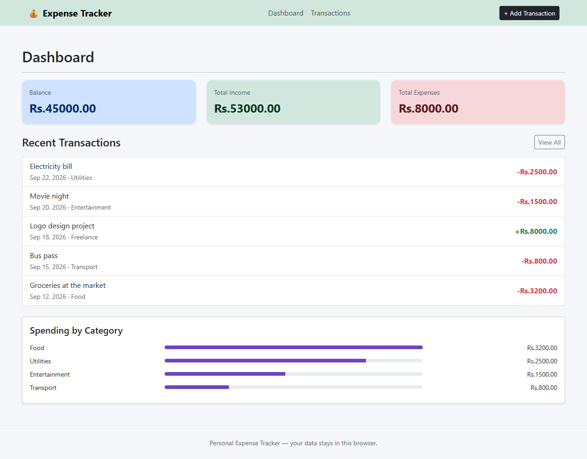
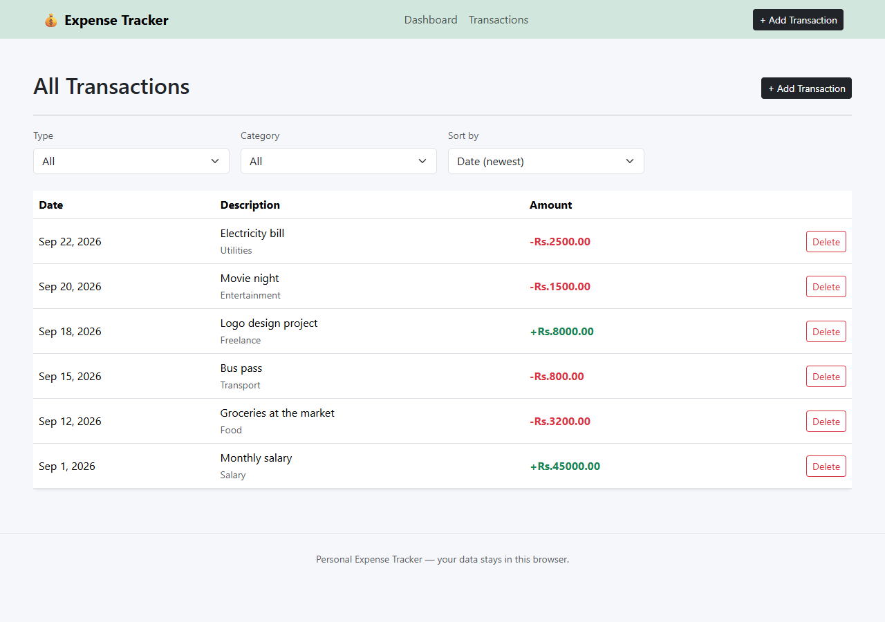
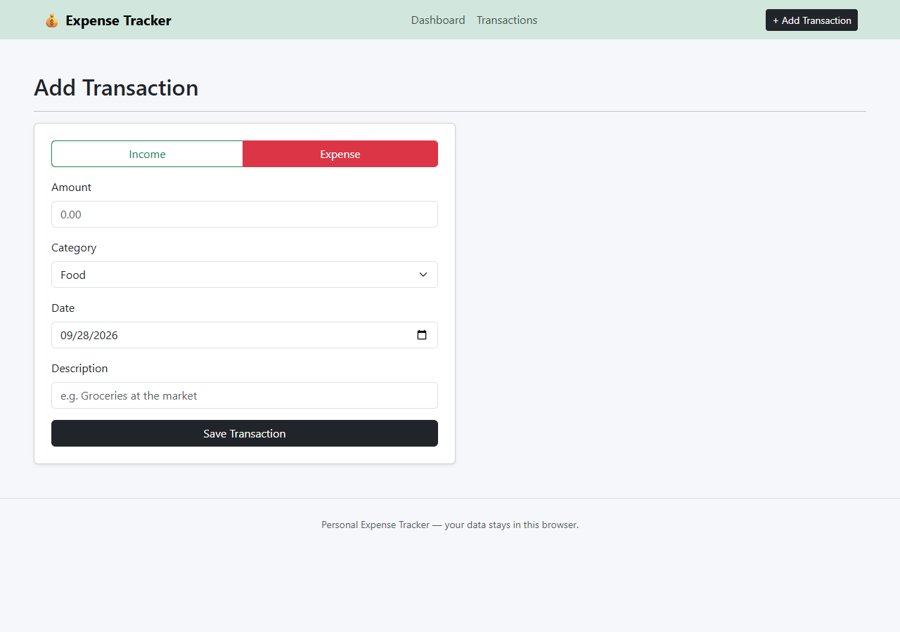

# Personal Expense Tracker

Personal Expense Tracker is a React single-page app for logging income and expenses across multiple pages (Dashboard, Transactions, Add Transaction). It tracks a running balance, breaks down spending by category, and saves everything to your browser's `localStorage` so your data survives a refresh.

## Features Implemented

- Add income or expense transactions with an amount, category, description, and date.
- Live running balance (`income − expenses`), plus separate income and expense totals shown on the Dashboard.
- Dedicated Transactions page listing full history, with the ability to delete any entry (confirmed via a SweetAlert2 dialog).
- Filter transactions by type (income/expense) and by category.
- Sort transactions by date (newest/oldest) or amount (high/low).
- Client-side routing (React Router) across Dashboard, Transactions, and Add Transaction pages, sharing state through React Context.
- Data persists automatically to `localStorage`.
- Distinct empty states for a brand-new ledger and for filters with no matches.
- **Stretch goal implemented:** "Spending by Category" breakdown with horizontal bar visualizations.
- Responsive layout using Bootstrap's grid system.

## Technologies Used

- [React](https://react.dev/) 19 — functional components and hooks only (`useState`, `useEffect`, `useContext`, `useMemo`)
- [React Router](https://reactrouter.com/) — client-side routing across Dashboard / Transactions / Add Transaction
- [Vite](https://vitejs.dev/) — dev server and build tool
- [Bootstrap 5](https://getbootstrap.com/) — layout and styling
- [SweetAlert2](https://sweetalert2.github.io/) — delete confirmations and form validation alerts
- Browser `localStorage` API for persistence

## Project Structure

```
personal-expense-tracker/
├── index.html
├── package.json
├── vite.config.js
└── src/
    ├── main.jsx                    # React entry point, loads Bootstrap
    ├── MyRoute.jsx                 # BrowserRouter + route definitions
    ├── constants.js                # Categories + formatting helpers
    ├── assets/                     # Custom styles
    ├── context/
    │   ├── TransactionsContext.jsx # Shared transaction state across pages
    │   └── transactions-context.js # Context object and useTransactions hook
    ├── hooks/
    │   └── useLocalStorage.js      # Persist state to localStorage
    ├── Components/
    │   ├── Header.jsx              # Navbar with page links
    │   ├── Footer.jsx
    │   ├── SummaryCard.jsx         # Balance / income / expense stat card
    │   ├── TransactionRow.jsx      # Single transaction table row
    │   └── CategoryBreakdown.jsx   # Spending-by-category bars
    └── pages/
        ├── Layout.jsx              # Header + Outlet + Footer, provides context
        ├── Homepage.jsx            # Dashboard: summary + recent transactions
        ├── Transactions.jsx        # Full history with filter/sort/delete
        └── AddTransaction.jsx      # Controlled form to add a new entry
```

## Setup Instructions

1. Make sure you have [Node.js](https://nodejs.org/) 18+ installed.
2. Install dependencies. If you received this project as a ZIP, do a clean install rather than copying a `node_modules` folder:
   ```bash
   npm install
   ```
3. Start the dev server:
   ```bash
   npm run dev
   ```
   Then open the printed local URL (usually `http://localhost:5173`) in your browser.
4. To build a production bundle:
   ```bash
   npm run build
   npm run preview
   ```

## Screenshots

### Dashboard

Running balance, recent transactions, and spending by category.



### Transactions

Full history with type, category, and sort controls, plus delete on each row.



### Add Transaction

Controlled form for income or expense, with amount, category, date, and description.



## Troubleshooting

If `npm run dev` says `vite is not recognized` or `vite: not found`, run `npm install` in the project folder first. Do not copy or keep a partially installed `node_modules` folder from another computer.

If the browser still shows old data after a code change, the app stores transactions in `localStorage`. Clear the site's local storage from the browser developer tools if you want a completely fresh ledger.

## Known Limitations

- No backend or accounts — all data lives in one browser's `localStorage` and won't sync across devices.
- No monthly summary view or budget-limit warnings (optional stretch goals not implemented in this pass).
- No drag-and-drop reordering; entries are ordered by the selected sort option only.
- Clearing browser storage/cache will erase saved transactions.
